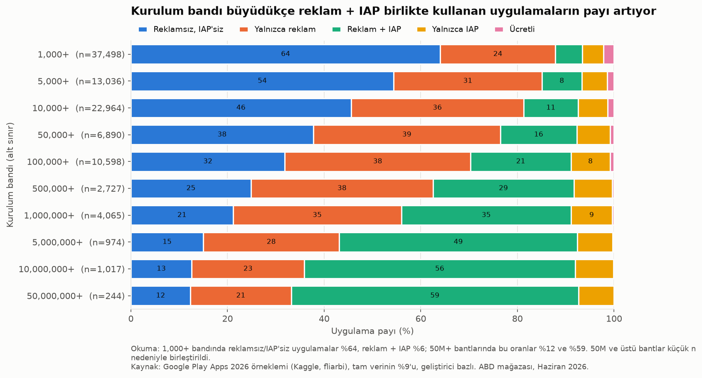
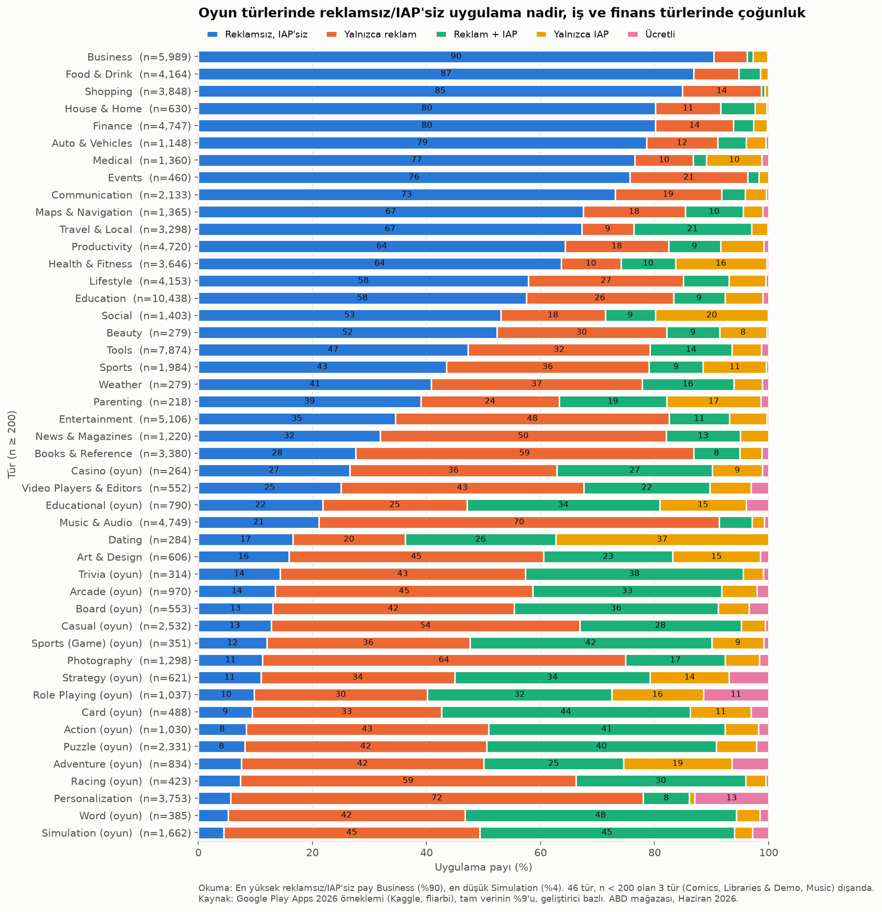
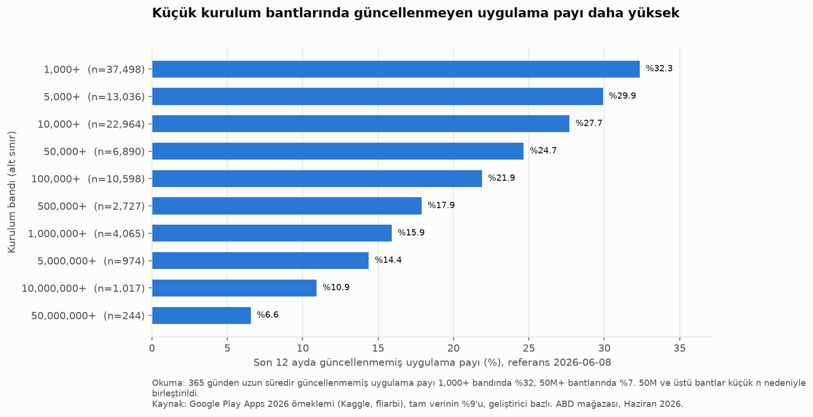
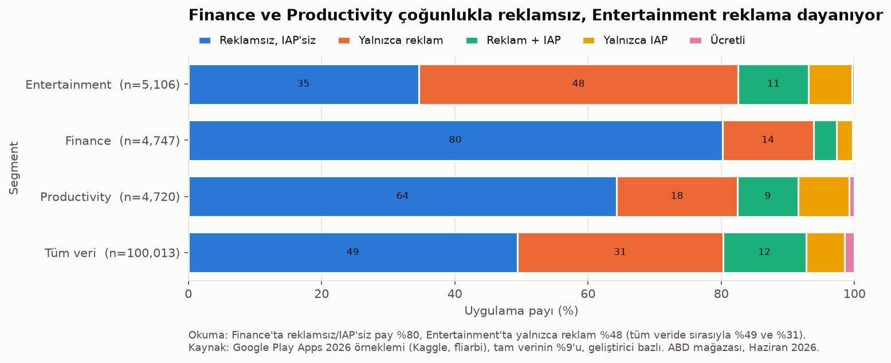

# Google Play Monetization by Genre and Install Band

    

> **Sample, not the whole store.** The data is a 9% developer-level hash sample of Google Play (100,013 of 1,101,050 apps): every app of the selected developers is included, so it is not a random sample of apps. US storefront, June 2026 snapshot, Android only. All findings are associations within this sample, not causes.

**Question:** How does the monetization model (ads, in-app purchases, paid, none) vary by genre and install band on Google Play?



## At a glance

| | |
|---|---|
| Apps | 100,013 (0 duplicates, 0 rows dropped) |
| Developers | 47,956 (developer + domain pairs), 79.9% with a single app |
| Genres | 49 (Sports games split into `Sports (Game)`), 46 with n ≥ 200 |
| Install bands | 15, from `1,000+` to `10,000,000,000+` |
| Apps with a rating | 31,755 (31.8%) |
| Sample check vs full data | ads 43.4% vs 43%, IAP 18.5% vs 18%, paid 1.48% vs 1.4% |
| Monetization mix | no ads & no IAP 49.4%, ads only 30.9%, ads + IAP 12.5%, IAP only 5.8%, paid 1.5% |

Each app is put into exactly one monetization model:

| Model | Rule |
|---|---|
| `paid` | `free = False` (paid apps that also show ads or sell IAP stay `paid`) |
| `ads_iap` | free, contains ads, offers IAP |
| `ads_only` | free, contains ads, no IAP |
| `iap_only` | free, no ads, offers IAP |
| `free_clean` | free, no ads, no IAP |

## Key findings
Every number describes this sample and shows association, not causation. Each finding has its own limitation.

**1. Ads + IAP rises with install band.**
At 1,000+ installs, 64.1% of apps use neither ads nor IAP and 5.6% use both (n = 37,498). At 10,000,000+, the shares are 12.6% and 56.1% (n = 1,017). Paid apps fall from 2.2% to 0.1%. *(chart above)*
*Limitation:* install bands are wide lower bounds (1,000,000+ means roughly 1M-5M). Larger apps also differ in age and in who builds them, so the band is not the only thing that changes along this axis.

**2. Games are ads-heavy, business and finance apps mostly use neither ads nor IAP.**
The share of apps with no ads and no IAP ranges from 90.4% in Business (n = 5,989) to 4.5% in Simulation (n = 1,662). 15 of the 20 genres with the lowest share are game genres. Personalization is the non-game outlier: 72.3% ads only, 13.0% paid.
*Limitation:* genre shares are sensitive to large developers that use a single model. For example, three keyboard/theme accounts publish 1,053 apps, about 99% of them ads only, and one watch-face developer has 175 of the 488 paid Personalization apps. Genres with n < 200 are excluded (Comics, Libraries & Demo, Music).

<details>
<summary><b>Monetization model by genre (46 genres, n ≥ 200)</b></summary>



</details>

**3. Apps in smaller install bands are more often stale.**
32.3% of apps at 1,000+ installs were not updated in the 12 months before the crawl (n = 37,498). The share is 15.9% at 1,000,000+ (n = 4,065) and 10.9% at 10,000,000+ (n = 1,017).
*Limitation:* `last_updated` is a single date. It does not show how big or how meaningful an update was, and the 365-day cutoff is a choice.

<p>
  
  
</p>

## Product takeaway
I compared the Productivity, Finance and Entertainment monetization profiles with three of my own apps. There is **no direct link**: the data shows which models are common in a genre, not which ones earn more or keep users. Two of the three apps are iOS only, and this is Android data.

| Segment (n) | No ads, no IAP | Ads only | Ads + IAP | IAP only | Paid |
|---|---|---|---|---|---|
| Productivity (4,720) | 64.3% | 18.1% | 9.2% | 7.6% | 0.8% |
| Finance (4,747) | 80.2% | 13.7% | 3.5% | 2.4% | 0.3% |
| Entertainment (5,106) | 34.6% | 48.0% | 10.6% | 6.5% | 0.4% |
| All apps (100,013) | 49.4% | 30.9% | 12.5% | 5.8% | 1.5% |

- **SpendWise** (bill and subscription tracker, iOS) → Finance. In this sample, 80% of Finance apps use neither ads nor IAP. The data does not show how many of them are stand-alone trackers like SpendWise and how many are companion apps for a bank or a service, so this norm is weak context.
- **PomoQuest** (gamified Pomodoro timer, iOS) → Productivity. IAP only (7.6%) is a small but above-average share in Productivity. The game-like design does not move it into game genres, where ads dominate.
- **Pairplot** (shared watchlist for couples, Flutter iOS + Android) → Entertainment. This is the most ad-heavy of the three genres (48% ads only), so going without ads would set it apart from most of the genre. The data cannot say whether that helps.

## SQL
The cleaned data is loaded into four normalized SQLite tables ([`sql/schema.sql`](sql/schema.sql)):

```
apps ──┬── developers     (developer_id = developer + domain pair)
       ├── genres         (genre, is_game)
       └── install_bands  (installs, band_rank, installs_min)
```

[`sql/queries.sql`](sql/queries.sql) answers 10 questions with GROUP BY, JOIN, CASE, HAVING, window functions (`RANK`, `ROW_NUMBER`, `SUM OVER`) and CTEs, for example:

| # | Question | Technique |
|---|---|---|
| Q2 | Monetization mix per install band | JOIN + CASE pivot |
| Q3 | Top 10 genres by ad share (n ≥ 200) | HAVING |
| Q5 | Top 3 rated apps per genre | ROW_NUMBER over PARTITION BY |
| Q8 | Cumulative share of genres (top 10 = 55.8% of apps) | SUM OVER |
| Q9 | Share of apps not updated in 12 months per band | JOIN + `AVG(condition)` |
| Q10 | Productivity / Finance / Entertainment vs all apps | CTE + UNION ALL |

## Dashboard
A Streamlit dashboard ([`app/dashboard.py`](app/dashboard.py)) with three tabs (genre × monetization, install band × monetization, developer concentration) and filters for genre, game/app and install band. Every chart shows n, and a fixed note at the top states the sample design.

The dashboard **never reads raw rows**. It reads one summary table, [`app/summary/developer_cells.csv.gz`](app/summary/), built by [`src/build_summaries.py`](src/build_summaries.py): app counts per developer × genre × install band × monetization (69,841 cells, n = 100,013). It has no app names or IDs. Developer names are shown only for developers with at least 20 apps in the sample (389 of 47,956); the rest appear as `Geliştirici #<number>`. This is why it can run without `data/` and can be deployed publicly.

```
streamlit run app/dashboard.py
```

## Limitations
- **Sampling:** a developer-level hash sample, not a random sample of apps. Overall shares match the full data within 0.5 points, but a few large developers that use a single model can shift genre-level shares.
- **Install bands** are public lower bounds, not exact counts. The six bands at 50M+ (n = 244 combined) are merged in the charts.
- **Ratings** exist for only 31.8% of apps, and that subset leans towards paid apps (65% of paid apps are rated vs 31% of free apps).
- **Scope:** US storefront, June 2026 snapshot, Android only. It cannot be read directly as an iOS result.
- **Developer identity:** "Individual developer" with no domain is a generic label that groups many different people (6,022 apps) and is reported separately. The same company can appear as two developers when its domain is missing in some rows (e.g. WABiz).
- **Paid apps** that also show ads or sell IAP (95 and 224 apps) are counted only as `paid`.

## Method
1. **Validate** the raw CSV: shape, types, missing values, duplicates, outliers ([`src/validate.py`](src/validate.py)).
2. **Clean** and derive `monetization`, `installs_min`, `is_rated`, `release_year`, `days_since_update` (reference date 2026-06-08, the crawl date, not today). No rows are dropped. "Sports" is used for both games and apps, so Sports games become `Sports (Game)` ([`src/clean.py`](src/clean.py)).
3. **Check the sample** against published full-data shares and measure developer concentration, without reweighting ([`src/sample_check.py`](src/sample_check.py)).
4. **Load** into SQLite ([`src/load_db.py`](src/load_db.py)) and **query** ([`src/queries.py`](src/queries.py)).
5. **Chart** with numbers taken from code, never typed by hand ([`src/figures.py`](src/figures.py)).

Every decision and assumption is logged in [`DEVLOG.md`](DEVLOG.md). The QA checklist is in [`05-kalite-kontrol.md`](05-kalite-kontrol.md).

## Reproduce
```
python -m venv .venv && source .venv/bin/activate
pip install -r requirements.txt
kaggle datasets download -d fliarbi/google-play-apps-2026 -p data/ --unzip   # needs a Kaggle API token
jupyter nbconvert --to notebook --execute --inplace notebooks/analysis.ipynb  # full pipeline: data/apps.db + figures/
streamlit run app/dashboard.py
```

## Structure
```
├── app/dashboard.py          Streamlit dashboard (reads app/summary/ only)
├── app/summary/              aggregated table for the dashboard (no app-level rows)
├── notebooks/analysis.ipynb  executed end-to-end notebook
├── sql/schema.sql            normalized SQLite schema
├── sql/queries.sql           10 SQL questions
├── src/                      pipeline modules (validate, clean, sample_check, load_db, queries, figures, build_summaries)
├── figures/                  4 charts
├── data/                     raw and generated data (git-ignored)
├── DEVLOG.md                 decisions, assumptions and step log (Turkish)
└── 05-kalite-kontrol.md      QA checklist (Turkish)
```

## Data and license
- Source: [Google Play Apps 2026 on Kaggle](https://www.kaggle.com/datasets/fliarbi/google-play-apps-2026). The data is not included in this repo.
- License: **CC BY-NC-SA 4.0** (as listed on the Kaggle page): non-commercial use, attribution required, share-alike. The charts and tables here are derived from that data and are shared under the same terms. The REPORT.md bundled with the download says CC BY-NC 4.0; the Kaggle listing is followed.
- Citation: Fliar Research (2026). *Google Play Apps 2026 (1.1M apps, 1K+ installs)* (sample release). Licence CC BY-NC-SA 4.0.
